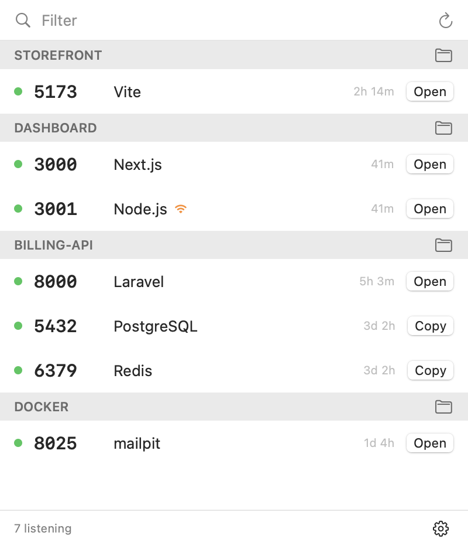

# LocalServer

A macOS menu bar app that shows every local port — Vite, Laravel, Next.js, Docker, Postgres — with the project it belongs to. Open, restart, tail logs, share or stop any of them in one click.

<p align="center"></p>

## Features

- **Grouped by project** — resolved from the process's working directory (git root, `package.json`, `composer.json`, …).
- **Framework detection** — Vite, Next.js, Nuxt, Astro, Laravel, Django, Rails, Uvicorn and more; databases like PostgreSQL, MySQL, Redis, MongoDB.
- **Docker aware** — containers appear on their host ports, grouped by compose project.
- **One-click actions** — hover a row for the rest:
  - **Open** in the browser (**Copy** for databases)
  - **Restart** — relaunches with the original args, env and working directory (wrapper chains like `npm run dev` included)
  - **Logs** — follows the process's log file in Terminal (`docker logs -f` for containers)
  - **Share** — copy localhost / LAN URL, or start a public tunnel (`cloudflared` or `ngrok`)
  - **Stop** — SIGTERM, then SIGKILL; databases and containers ask for a second click
- Orange wifi icon = listening on all interfaces (reachable from your network).
- System daemons and apps (ControlCenter, Raycast…) are hidden unless enabled in the gear menu.

## Build & install

Requires macOS 14+ and the Swift toolchain (Xcode or Command Line Tools).

```sh
./build.sh           # build build/LocalServer.app
./build.sh run       # build and launch
./build.sh install   # build, copy to /Applications, launch
```

"Launch at login" only works once the app is in `/Applications`. The app is ad-hoc signed and not sandboxed — it needs to inspect and signal your processes.

## Debug helpers

```sh
LocalServer --scan                    # print what the app sees
LocalServer --act kill|restart <port>
LocalServer --screenshot out.png      # render the popover with sample data
```

Public tunnels need `cloudflared` or `ngrok`: `brew install cloudflared`.
