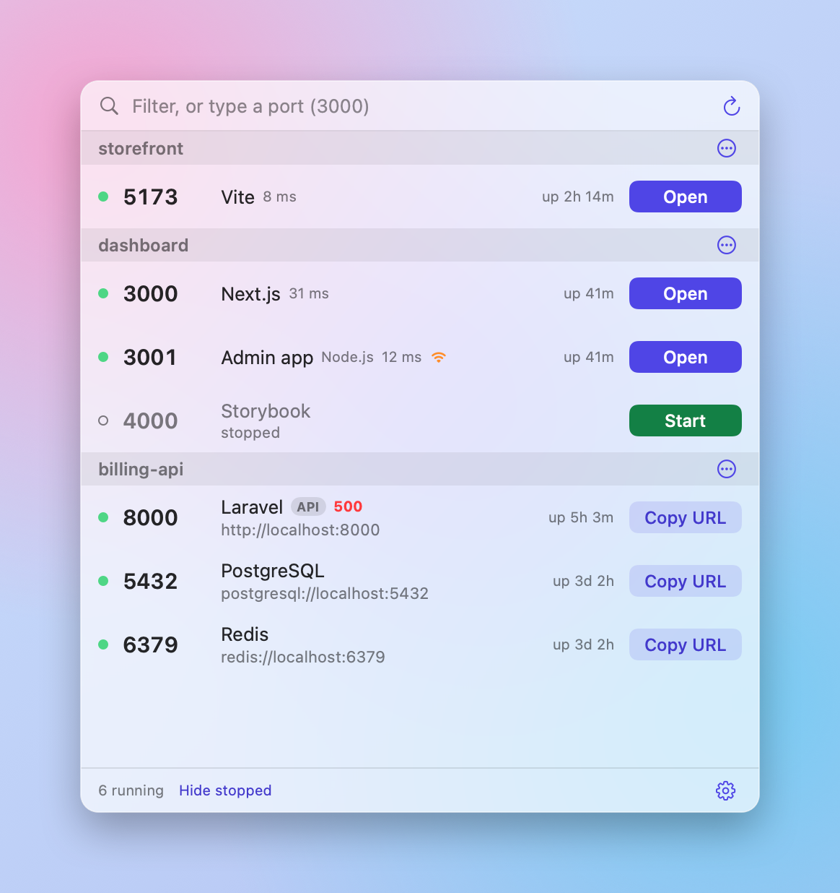
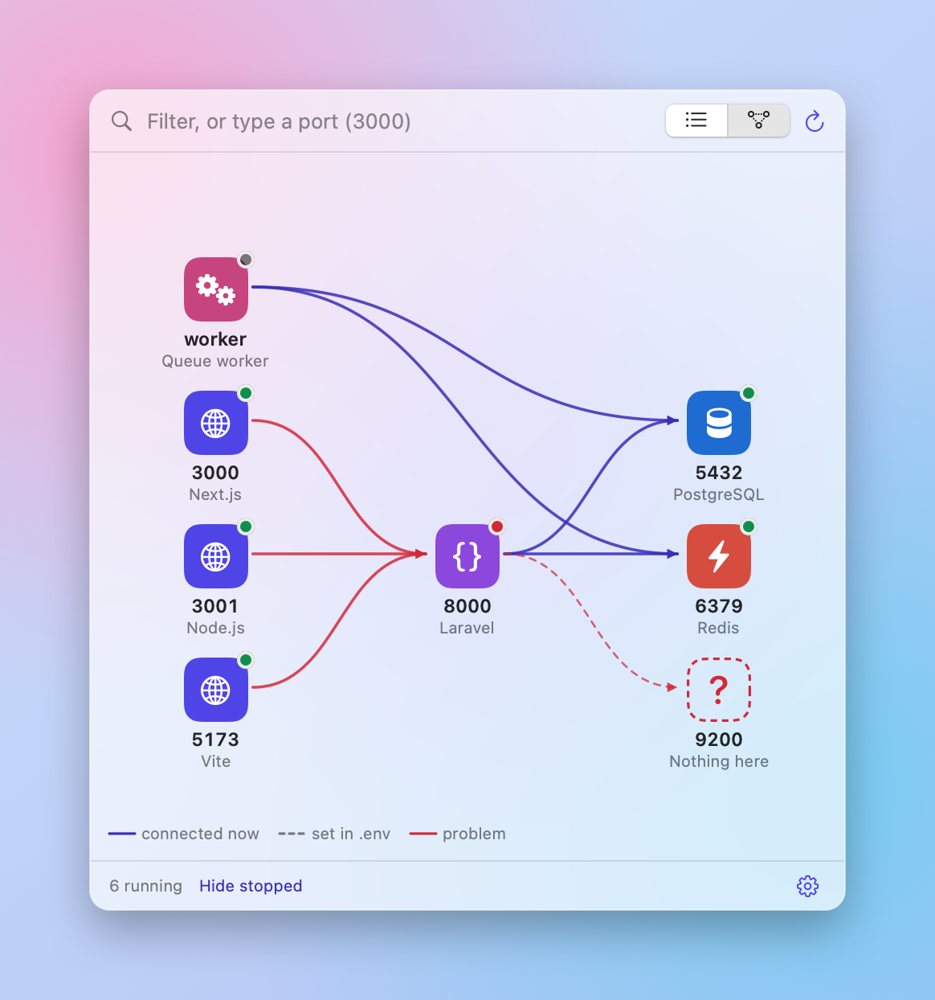

# Switchboard

**Every local port, with its project.**

Switchboard sits in your Mac menu bar and shows everything running on localhost, grouped by the project it belongs to. Open it, restart it, read its logs or stop it without going back to the terminal.

Free and open source. [Website](https://destucr.github.io/Switchboard/) · [Download](https://github.com/destucr/Switchboard/releases/latest)

<p align="center">
  <picture>
    <source media="(prefers-color-scheme: dark)" srcset="docs/screenshot-dark.png">
    
  </picture>
  <picture>
    <source media="(prefers-color-scheme: dark)" srcset="docs/screenshot-map-dark.png">
    
  </picture>
</p>

## Features

- **Know what is running.** Every server, grouped by project. Vite, Next.js, Laravel, Django, Docker, Postgres, Redis and more.
- **The right button every time.** Open for web pages. Copy URL for APIs and databases.
- **See what depends on what.** A map shows which servers talk to each other, and warns you before you stop one that others are using.
- **Pick up where you left off.** Stopped servers stay on the list. One click starts the whole project again, in the right order.
- **Share your setup.** Save a `switchboard.json` in your repo. A teammate adds the folder and presses Start stack.
- **No more "port already in use".** Type a port to see who has it. If a port is taken, Switchboard offers the next free one. You can also move a running server to another port, and undo it.

## Install

```sh
brew install --cask destucr/tap/switchboard
```

Or download the zip from [Releases](https://github.com/destucr/Switchboard/releases).

Switchboard is not notarized yet, so macOS asks you to confirm the first launch. Open System Settings, then Privacy & Security, and click Open Anyway. You can also run this once:

```sh
xattr -dr com.apple.quarantine /Applications/Switchboard.app
```

## Command line

The cask also installs a `switchboard` command for the terminal:

```sh
switchboard status [--json]    # what is running
switchboard export             # write switchboard.json from what you have run
switchboard start              # start the stack in order
switchboard stop               # stop it, front ends first
```

`switchboard.json` holds commands and dependencies only. Environment variables are never saved.

## Build

Needs macOS 14+ and Xcode or the Command Line Tools.

```sh
./build.sh install    # build, copy to /Applications, start
./scripts/check.sh    # build with no warnings, then the self-test
./release.sh minor    # check, bump, tag, publish, update the Homebrew cask (--dry-run first)
```

## Contributing

Versions, the changelog and the release checks are described in [RELEASING.md](RELEASING.md).

## License

MIT
